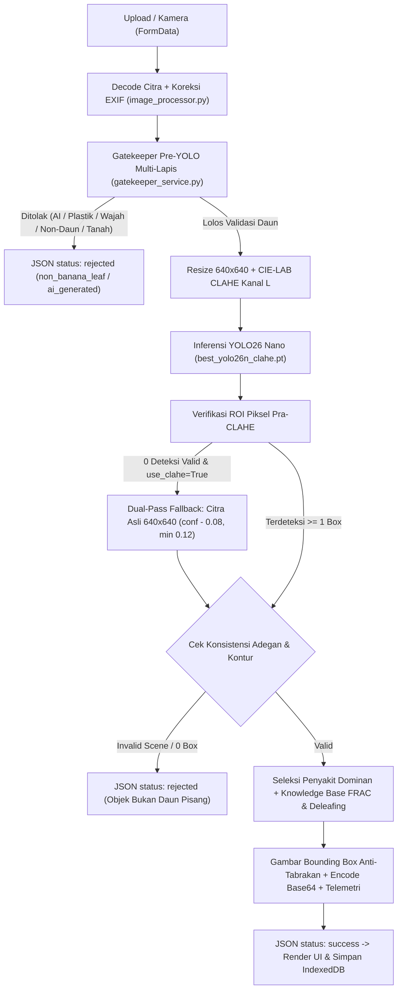

# MusaVision

**MusaVision** adalah platform web deteksi dini penyakit daun pisang berbasis **YOLO26 Nano**, penajaman mikrokontras **CIE-LAB CLAHE**, sistem validasi citra **Gatekeeper Multi-Lapis**, serta rekomendasi sanitasi kebun (*deleafing*) dan rotasi fungisida berstandar internasional **FRAC** (*Fungicide Resistance Action Committee*).

Sistem ini dibangun dengan arsitektur modular Python Flask di sisi backend dan HTML5, Tailwind CSS, CSS modular, serta Vanilla JavaScript ES Modules di sisi frontend agar mudah dioperasikan petani langsung di lahan melalui ponsel maupun didemonstrasikan untuk pengujian akademik.

---

## Ringkasan Teknis

| Komponen | Spesifikasi Implementasi |
| :--- | :--- |
| **Backend Framework** | Python (`>= 3.10`), Flask (`>= 3.0.0`) dengan pola *Application Factory* & Blueprints |
| **Model Deteksi Utama** | Ultralytics (`>= 8.3.0`) YOLO26 Nano (`models/best_yolo26n_clahe.pt`) pada resolusi `640x640` |
| **Prapemrosesan Citra** | OpenCV CIE-LAB CLAHE pada kanal luminansi `L` (`clipLimit=2.0`, `tileGridSize=8x8`) |
| **Validasi Objek (Gatekeeper)** | 7 lapis validasi pre-YOLO & post-YOLO (EXIF/AI check, OpenCV HSV/YCrCb/Laplacian, Haar Cascade, HOG, MobileNetV3-Small) |
| **Performa Model (Epoch 50)** | Precision `83.29%` · Recall `81.75%` · **mAP@50 `85.34%`** · mAP@50-95 `63.82%` |
| **Evaluasi Usabilitas (SUS)** | Skor **84.0** (Kategori *Excellent*, skala Brooke) |
| **Penyimpanan Sisi Klien** | Persistent **IndexedDB** (`MusaVisionDB`, store `detection_history`) + fallback `localStorage` & ekspor `.CSV` |
| **Batas Ukuran Unggahan** | Maksimal `16 MB` (`jpg`, `jpeg`, `png`, `webp`) |

---

## Daftar Isi

1. [Fitur Utama](#fitur-utama)
2. [Alur Kerja & Arsitektur Pipeline ML](#alur-kerja--arsitektur-pipeline-ml)
3. [5 Kelas Kondisi Daun & Rekomendasi Agronomi](#5-kelas-kondisi-daun--rekomendasi-agronomi)
4. [Hasil Pelatihan & Evaluasi Model](#hasil-pelatihan--evaluasi-model)
5. [Struktur Proyek (Clean Architecture)](#struktur-proyek-clean-architecture)
6. [Instalasi & Menjalankan Secara Lokal](#instalasi--menjalankan-secara-lokal)
7. [Dokumentasi Route & Kontrak API](#dokumentasi-route--kontrak-api)
8. [Catatan Persiapan Sebelum Push ke GitHub](#catatan-persiapan-sebelum-push-ke-github)
9. [Dokumen Spesifikasi Pendukung](#dokumen-spesifikasi-pendukung)

---

## Fitur Utama

### 1. Halaman Publik & Edukasi Kebun (`/`)
- **Hero Editorial & Slideshow:** Menampilkan orientasi nilai sistem, indikator model, serta akses langsung ke workspace deteksi dan panduan sanitasi.
- **Ringkasan Keunggulan & Validasi Metrik:** Menjelaskan integrasi Gatekeeper, CIE-LAB CLAHE, YOLO26 Nano, skor SUS (`84.0`), akurasi validasi (`85.34% mAP@50`), dan standar kanopi (`6-8 daun sehat`).
- **3 Pilar Sanitasi Kebun:** Edukasi terstruktur meliputi pemangkasan sanitasi (*deleafing*), rotasi bahan aktif fungisida kode FRAC, serta manajemen kanopi dan drainase lahan.
- **Pratinjau Katalog Patogen & FAQ Petani:** Ringkasan 5 kelas kondisi daun yang tertaut ke katalog detail, dilengkapi akordeon tanya jawab praktis lapangan.

### 2. Workspace Deteksi AI (`/deteksi`)
- **Input Fleksibel (Mobile-First):** Mendukung pemilihan berkas (`JPG`, `PNG`, `WEBP`), *drag-and-drop*, serta tangkapan kamera belakang ponsel langsung (`capture="environment"`), disertai penyesuaian orientasi otomatis berdasarkan metadata EXIF kamera.
- **Galeri Sampel Uji Terkurasi:** Menyediakan 5 foto sampel standar kebun (`/api/samples` & `/sample-file/...`) untuk demonstrasi dan uji cepat instan tanpa perlu mengunggah berkas manual.
- **Panel Pengaturan Peneliti (`<details>` Terlipat):** Pengaturan default ramah petani (`use_clahe = true`, `conf = 0.25`, `iou = 0.45`) tersembunyi rapi dalam panel terlipat bagi penguji/peneliti yang ingin mengatur *confidence threshold*, *IoU NMS*, atau membandingkan mode tanpa CLAHE.
- **Visualisasi 3 Tahap & Lightbox Interaktif:** Pengguna dapat beralih cepat antara `Hasil Deteksi` (bounding box + label bebas tabrakan), `CIE-LAB CLAHE` (kanal L dipertajam), dan `Foto Asli` (`640x640`), dilengkapi tampilan layar penuh (*lightbox*) dan unduhan JPG.
- **Diagnosis Dominan, Granularitas, & Rekomendasi FRAC:** Menentukan patogen utama berdasarkan urutan prioritas keganasan biologis (`Black Sigatoka` > `Yellow Sigatoka` > `Cordana` > `Pestalotiopsis` > `Fresh`), memisahkan jumlah deteksi level bercak (`Lesion-Level`) dan level helai daun (`Leaf-Level`), menampilkan koordinat bounding box `[x1, y1, x2, y2]`, protokol pemangkasan (*deleafing*), jadwal rotasi FRAC, peringatan PPL/POPT, serta telemetri latensi (`preprocess_ms`, `inference_nms_ms`, `postprocess_ms`, `server_total_ms`, `client_roundtrip`).
- **Riwayat Pengujian Lapangan (IndexedDB):** Menyimpan riwayat analisis secara persisten di peramban (`MusaVisionDB`), lengkap dengan tampilan tabel desktop, kartu vertikal mobile, modal detail riwayat, dan ekspor ke format `.CSV`.

### 3. Atlas Patogen Daun Pisang (`/katalog-patogen`)
- Menyediakan *dossier* interaktif untuk ke-5 kelas dataset (`Sigatoka Hitam`, `Sigatoka Kuning`, `Bercak Cordana`, `Pestalotiopsis`, dan `Daun Sehat`) beserta tabel matriks komparasi gejala visual, risiko panen, protokol sanitasi, dan kode fungisida FRAC.

---

## Alur Kerja & Arsitektur Pipeline ML

Setiap citra yang dikirimkan ke `POST /predict` melewati pipeline pemrosesan berlapis di [`musavision/services/diagnosis_service.py`](musavision/services/diagnosis_service.py):



### Detail Lapisan Gatekeeper (`gatekeeper_service.py`)
Agar model tidak memproduksi *false positive* saat diarahkan ke objek selain daun pisang, sistem menerapkan validasi sebelum dan sesudah inferensi:
1. **Deteksi Citra Sintetis AI (`detect_ai_generated_image`):** Memeriksa jejak nama file (`midjourney`, `dall-e`, `stable diffusion`, `comfyui`, dll.), metadata biner C2PA/XMP/PNG (`parameters`, `prompt`, `workflow`, EXIF `Software`), serta resolusi generatif umum tanpa EXIF kamera asli disertai tekstur terlalu halus (*hyper-smooth Laplacian variance*).
2. **Filter Daun Plastik / Sintetis:** Menolak citra hijau yang terlalu seragam dengan pantulan spekular tinggi dan variansi tekstur Laplacian rendah (`lap_var < 35.0`).
3. **Deteksi Wajah & Tubuh Manusia:** Menggunakan OpenCV `haarcascade_frontalface_default`, `haarcascade_frontalface_alt2`, dan `HOGDescriptor` yang diverifikasi silang terhadap masker kulit HSV & YCrCb agar foto *selfie* atau pekerja kebun tanpa dominasi daun ditolak.
4. **Filter Dominasi Kulit & Langit/Air:** Menolak citra dengan rasio kulit manusia tinggi atau unsur air/langit biru terbuka di pemandangan.
5. **ImageNet Semantic Guard (`MobileNet_V3_Small`):** Memeriksa 10 kelas probabilitas teratas MobileNetV3 (dengan daftar kategori non-daun, pot/wadah, dan tanaman hias non-pisang) untuk menyaring benda rumah tangga, hewan, makanan, pot tanaman, maupun pemandangan non-pisang. Jika `torchvision` tidak tersedia, modul otomatis berjalan dengan mode fallback berbasis OpenCV.
6. **Analisis Morfologi Kontur & Spektrum Botani:** Mengevaluasi rasio spektrum hijau, kuning klorosis, dan cokelat nekrotik (`botanical_ratio >= 0.20`), ukuran kontur terbesar (`largest_blob_ratio >= 0.18`), serta menolak latar tanah/kayu atau citra terlalu gelap.
7. **Verifikasi ROI Pasca-YOLO (`verify_yolo_boxes_against_raw_pixels`):** Setiap *bounding box* prediksi YOLO diverifikasi ulang menggunakan piksel **pra-CLAHE** agar kontras buatan tidak memicu deteksi palsu pada kulit manusia, tanah kering, atau pinggiran non-daun.

### Penajaman CIE-LAB CLAHE (`image_processor.py`)
Pada kondisi kebun terbuka dengan bayangan pelepah atau cahaya terik, fitur tekstur bercak jamur sering tersamar. Sistem mengonversi citra `640x640` dari ruang warna `BGR` ke `CIE-LAB`, lalu menerapkan CLAHE (`clipLimit = 2.0`, `tileGridSize = 8x8`) **hanya pada kanal luminansi `L`**, sementara kanal kromatik `A` (hijau-merah) dan `B` (biru-kuning) dipertahankan utuh agar ciri warna alami klorosis dan nekrosis tidak bergeser.

### Dual-Pass Fallback
Apabila opsi `use_clahe` aktif dan inferensi pertama menghasilkan `0` deteksi terverifikasi, `diagnose_leaf_image` otomatis menjalankan inferensi ulang pada citra asli (`resized_bgr`) dengan penurunan `conf_threshold` sebesar `0.08` (batas minimum `0.12`). Mekanisme ini mencegah *contrast washout* pada foto kebun yang sudah memiliki kontras alami tinggi.

---

## 5 Kelas Kondisi Daun & Rekomendasi Agronomi

Definisi lengkap kelas, granularitas, dan protokol penanganan berada di [`musavision/data/pathology_kb.py`](musavision/data/pathology_kb.py). Granularitas ditentukan dinamis: `Leaf-Level (Cakupan Helai Daun)` untuk kelas `Fresh`, `Yellow Sigatoka`, atau kotak dengan rasio luas `>= 35.0%` terhadap kanvas `640x640`; serta `Lesion-Level (Titik Bercak)` untuk rasio luas `< 35.0%`.

| Prioritas | Kelas Model | Nama Penyakit & Patogen | Warna Anotasi | Granularitas Default | Protokol Sanitasi (*Deleafing*) | Kode Rotasi FRAC |
| :---: | :--- | :--- | :---: | :--- | :--- | :--- |
| 1 | `Black Sigatoka` | **Sigatoka Hitam** (*Pseudocercospora fijiensis*) | `#dc2626` | *Lesion-Level* | Pangkas bagian nekrotik hitam dengan pisau bersih, kumpulkan di luar area tanam; sisakan minimal **6-8 daun sehat/pohon** | `FRAC 3` (Triazol: Difenoconazole/Tebuconazole) rotasi dengan `FRAC 11` (Strobilurin: Azoxystrobin) |
| 2 | `Yellow Sigatoka` | **Sigatoka Kuning** (*Pseudocercospora musae*) | `#eab308` | *Leaf-Level* | Pangkas tepi/lembaran menguning & kering parah; pertahankan minimal **6-8 daun fungsional** | `FRAC 3` atau `FRAC 11` bergilir, dapat dikombinasikan dengan kontak `FRAC M03/M05` |
| 3 | `Cordana` | **Bercak Daun Cordana** (*Cordana musae*) | `#f97316` | *Lesion-Level* | Pangkas bagian tepi daun berbercak oval kering tanpa menghabiskan pelepah sehat | Kontak protektif ekonomis `FRAC M03` (Mancozeb) / `FRAC M05` (Chlorothalonil) |
| 4 | `Pestalotiopsis` | **Bercak Daun Pestalotiopsis** (*Pestalotiopsis microspora / leprogena*) | `#8b5cf6` | *Lesion-Level* | Bersihkan ujung dan pinggiran helai daun robek yang mengering untuk menekan sumber spora | Kontak protektif `FRAC M03` (Mancozeb) / `FRAC M05` (Chlorothalonil) saat meluas di musim hujan |
| 5 | `Fresh` | **Daun Sehat** (*Musa spp.*) | `#16a34a` | *Leaf-Level* | Tidak perlu pemangkasan sanitasi; pertahankan **6-8 daun sehat** hingga pengisian tandan buah | **Tidak diperlukan penyemprotan fungisida** |

> **Catatan PPL / POPT:** Setiap hasil diagnosis menyertakan peringatan agar rotasi antar-kode FRAC dilakukan maksimal 2 kali berturut-turut per golongan bahan aktif untuk mencegah resistensi patogen jamur, serta verifikasi dosis lapangan bersama Penyuluh Pertanian Lapangan (PPL) atau POPT setempat.

---

## Hasil Pelatihan & Evaluasi Model

Artefak hasil pelatihan, kurva PR/F1, *confusion matrix*, dan tabel evaluasi tersimpan di folder [`MusaVision_Sidang_Data/`](MusaVision_Sidang_Data/).

### Konfigurasi Pelatihan Model Utama (`4_YOLO26n_LAB_CLAHE/args.yaml`)
- **Arsitektur Dasar:** `yolo26n.pt` (pretrained)
- **Resolusi Input:** `640x640`
- **Epoch & Batch:** `50 epochs`, `batch = 16`, `amp = true`, `seed = 42`
- **Optimizer & Learning Rate:** `optimizer = auto`, `lr0 = 0.01`, `lrf = 0.01`, `momentum = 0.937`, `weight_decay = 0.0005`
- **Metrik Validasi Epoch 50 (`4_YOLO26n_LAB_CLAHE/results.csv`):** Precision `83.29%` (`0.83292`), Recall `81.75%` (`0.81747`), **mAP@50 `85.34%` (`0.85337`)**, dan mAP@50-95 `63.82%` (`0.63816`).

### Perbandingan 4 Skenario Arsitektur (`MusaVision_Sidang_Data/tabel_komparasi.csv`)

| Skenario Arsitektur | Precision (%) | Recall (%) | mAP@50 (%) | mAP@50-95 (%) |
| :--- | :---: | :---: | :---: | :---: |
| `1_YOLOv8n_Raw` | 82.62 | 78.73 | 83.27 | 62.67 |
| `2_YOLO11n_Raw` | 81.41 | 79.31 | 83.10 | 62.96 |
| `3_YOLO26n_Raw` | 83.73 | 80.55 | 84.72 | 64.06 |
| `4_YOLO26n_LAB_CLAHE` | **84.09** | 78.92 | 84.20 | 63.91 |

### Performa Deteksi Per Kelas (`MusaVision_Sidang_Data/tabel_ap_kelas.csv`)

| Kelas Penyakit | Precision (%) | Recall (%) | AP@50 (%) |
| :--- | :---: | :---: | :---: |
| `Black Sigatoka` | 78.07 | 65.94 | 72.54 |
| `Cordana` | 87.75 | 86.67 | 92.87 |
| `Fresh` | 99.56 | 100.00 | 99.50 |
| `Pestalotiopsis` | 67.98 | 54.91 | 64.48 |
| `Yellow Sigatoka` | 87.09 | 87.07 | 91.63 |

### Evaluasi Usabilitas
- **System Usability Scale (SUS):** `84.0` (Kategori **Excellent** menurut standar interpretasi Brooke).

---

## Struktur Proyek (Clean Architecture)

Proyek ini memisahkan lapisan konfigurasi, domain data agronomi, layanan inferensi/validasi murni, routing HTTP Flask, template komponen Jinja2, CSS terstruktur, serta modul ES JavaScript:

```text
Musa Vision Skripsi/
|-- app.py                               # Entry point WSGI & dev server (memanggil create_app())
|-- requirements.txt                     # Dependensi Python (Flask, Ultralytics, OpenCV, NumPy, Pillow)
|-- .gitignore                           # Pengecualian cache, venv, arsip zip, dan skrip utilitas lokal
|-- README.md                            # Dokumentasi proyek lengkap
|-- models/
|   `-- best_yolo26n_clahe.pt            # Bobot model terlatih YOLO26 Nano + CIE-LAB CLAHE (prioritas 1)
|-- musavision/                          # Paket utama backend Flask
|   |-- __init__.py                      # Application Factory (create_app) + warm-up bobot & registrasi Blueprints
|   |-- config.py                        # Path direktori, batas unggahan, threshold Gatekeeper & kata kunci AI/ImageNet
|   |-- data/
|   |   |-- __init__.py
|   |   `-- pathology_kb.py              # Knowledge base 5 kelas (gejala, deleafing, FRAC, PPL, warna, prioritas)
|   |-- routes/
|   |   |-- __init__.py
|   |   |-- web_routes.py                # Blueprint SSR halaman web (/, /deteksi, /katalog-patogen)
|   |   `-- api_routes.py                # Blueprint JSON API (/predict, /api/samples, /sample-file/<filename>)
|   `-- services/
|       |-- __init__.py
|       |-- diagnosis_service.py         # Orkestrasi pipeline end-to-end & scanner daftar sampel
|       |-- gatekeeper_service.py        # Validasi pre-YOLO & post-YOLO anti objek asing / AI-generated
|       |-- image_processor.py           # Decode EXIF, resize, CIE-LAB CLAHE kanal L, render bbox & Base64
|       `-- yolo_detector.py             # Singleton loader bobot YOLO & ekstraksi deteksi terstandar
|-- templates/                           # Template Jinja2 modular
|   |-- index.html                       # Halaman beranda (extends layouts/base.html)
|   |-- deteksi.html                     # Halaman workspace deteksi mandiri
|   |-- katalog_patogen.html             # Halaman atlas & matriks perbandingan patogen
|   |-- layouts/
|   |   `-- base.html                    # Kerangka HTML dasar, font editorial, Tailwind config, navbar, footer
|   |-- partials/
|   |   |-- navbar.html                  # Header navigasi adaptif (hero gelap & mode terang)
|   |   |-- mobile_menu.html             # Overlay navigasi mobile layar penuh (100dvh)
|   |   |-- footer.html                  # Floating footer card + conditional prefooter CTA
|   |   |-- modals.html                  # Modal lightbox citra & modal detail riwayat IndexedDB
|   |   |-- landing/                     # 10 bagian terpisah halaman utama
|   |   |   |-- hero.html
|   |   |   |-- marquee.html
|   |   |   |-- mission.html
|   |   |   |-- keunggulan.html
|   |   |   |-- deteksi_preview.html
|   |   |   |-- performa.html
|   |   |   |-- sanitasi.html
|   |   |   |-- katalog_preview.html
|   |   |   |-- faq.html
|   |   |   `-- prefooter.html
|   |   `-- deteksi/                     # 5 panel terpisah workspace deteksi
|   |       |-- tabs_nav.html
|   |       |-- tab_upload.html
|   |       |-- tab_samples.html
|   |       |-- tab_result.html
|   |       `-- tab_history.html
|   `-- samples/                         # 5 gambar sampel utama yang dipindai /api/samples
|-- static/
|   |-- css/
|   |   |-- base.css                     # Token warna, tipografi dasar, dan animasi dasar
|   |   |-- components.css               # Navbar, tombol, akordeon FAQ, tab workspace, kartu hasil
|   |   |-- pages.css                    # Gaya spesifik halaman landing, /deteksi, dan /katalog-patogen
|   |   `-- style.css                    # Aggregator @import berurutan untuk kompatibilitas mundur
|   |-- js/
|   |   |-- main.js                      # Orkestrator ES module kondisional per rute & binding global handler
|   |   `-- modules/
|   |       |-- navigation.js            # Smooth scroll, tracking section aktif, menu mobile, anti-flash hash
|   |       |-- animations.js            # Slideshow hero 3-slide, Lenis smooth scroll, GSAP word reveal
|   |       |-- accordion.js             # Interaksi akordeon keunggulan & FAQ
|   |       |-- detector.js              # Upload, kamera, sampel uji, fetch /predict, lightbox, unduh JPG, SUS
|   |       |-- history_db.js            # CRUD IndexedDB (MusaVisionDB), render tabel/mobile, ekspor CSV
|   |       `-- catalog.js               # Manajemen dossier & sinkronisasi URL query ?kelas=... di katalog
|   `-- samples/                         # Aset gambar lokal (hero, 3 pilar sanitasi, dan foto sampel)
|-- MusaVision_Sidang_Data/              # Artefak hasil pelatihan & pengujian (YOLOv8n, YOLO11n, YOLO26n, CLAHE)
`-- docs/                                # Dokumen desain & kebutuhan sistem (Design.md, PRD.md, dll.)
```

---

## Instalasi & Menjalankan Secara Lokal

### Prasyarat
- **Python 3.10 atau lebih baru**
- `pip` dan (disarankan) virtual environment (`venv`)
- Bobot model terlatih tersimpan di `models/best_yolo26n_clahe.pt` (sistem juga mendukung lokasi cadangan berurutan: `best_yolo26n_clahe.pt`, `models/best.pt`, `best.pt`, `models/yolo26n.pt` sesuai `MODEL_PATHS` di [`musavision/config.py`](musavision/config.py))
- *Opsional:* `torchvision` untuk mengaktifkan lapisan semantik MobileNetV3-Small (*ImageNet Guard*). Apabila `torchvision` tidak terpasang atau bobot ImageNet belum diunduh, sistem otomatis menggunakan Gatekeeper OpenCV tanpa gagal muat.

### Langkah Instalasi

1. **Clone repositori:**
   ```bash
   git clone https://github.com/muhbintangmahardani/Musa-Vision-Banana-Leaf-Diseases-II.git
   cd Musa-Vision-Banana-Leaf-Diseases-II
   ```

2. **Buat dan aktifkan virtual environment:**

   - **Windows (PowerShell):**
     ```powershell
     python -m venv .venv
     .\.venv\Scripts\Activate.ps1
     ```
   - **Linux / macOS:**
     ```bash
     python3 -m venv .venv
     source .venv/bin/activate
     ```

3. **Pasang seluruh dependensi Python:**
   ```bash
   pip install -r requirements.txt
   ```
   Isi utama [`requirements.txt`](requirements.txt): `flask>=3.0.0`, `ultralytics>=8.3.0`, `opencv-python>=4.9.0`, `numpy>=1.26.0`, `pillow>=10.0.0`.

4. **Jalankan server aplikasi:**
   ```bash
   python app.py
   ```
   Secara default aplikasi mendengarkan semua antarmuka jaringan pada port `5000` (dapat diubah lewat environment variable `PORT`):
   - Akses lokal: `http://127.0.0.1:5000`
   - Halaman workspace deteksi: `http://127.0.0.1:5000/deteksi`
   - Halaman katalog patogen: `http://127.0.0.1:5000/katalog-patogen`

---

## Dokumentasi Route & Kontrak API

### Route Halaman Web (`musavision/routes/web_routes.py`)

| Method | Endpoint | Template Dirender | Keterangan |
| :---: | :--- | :--- | :--- |
| `GET` | `/` | `templates/index.html` | Landing page utama (`active_page="landing"`, mengirim status `model_loaded` dan `model_path`) |
| `GET` | `/deteksi` | `templates/deteksi.html` | Workspace deteksi penyakit daun pisang interaktif |
| `GET` | `/katalog-patogen` | `templates/katalog_patogen.html` | Katalog interaktif & komparasi 5 kondisi daun |

### Endpoint REST API (`musavision/routes/api_routes.py`)

#### 1. `POST /predict`
Menjalankan validasi Gatekeeper, prapemrosesan CIE-LAB CLAHE, inferensi YOLO26 Nano, verifikasi piksel pasca-YOLO, serta mengembalikan diagnosis dan panduan agronomi FRAC.

- **Content-Type:** `multipart/form-data`
- **Parameter Form:**
  - `image` *(wajib)*: File gambar (`.jpg`, `.jpeg`, `.png`, `.webp`, maksimal `16 MB`).
  - `conf_threshold` *(opsional, float)*: Ambang keyakinan deteksi (default: `0.25`).
  - `iou_threshold` *(opsional, float)*: Ambang IoU Non-Maximum Suppression (default: `0.45`).
  - `use_clahe` *(opsional, `"true"` / `"false"`)*: Mengaktifkan penajaman CIE-LAB CLAHE pada kanal `L` (default: `"true"`).

**Contoh Request (`curl`):**
```bash
curl -X POST http://127.0.0.1:5000/predict \
  -F "image=@static/samples/sample_cordana.jpg" \
  -F "conf_threshold=0.25" \
  -F "iou_threshold=0.45" \
  -F "use_clahe=true"
```

**Contoh Response Berhasil (`200 OK`, `status: "success"`):**
```json
{
  "status": "success",
  "use_clahe": true,
  "conf_threshold": 0.25,
  "total_detections": 1,
  "lesion_level_count": 1,
  "leaf_level_count": 0,
  "class_counts": {
    "Cordana": 1
  },
  "dominant_class": "Cordana",
  "agronomy": {
    "display_name": "Bercak Daun Cordana (Cordana Leaf Spot)",
    "scientific_name": "Cordana musae",
    "severity_category": "Penyakit Jamur Sekunder (Kategori Ringan - Sedang)",
    "default_granularity": "Lesion-Level (Level Bercak)",
    "color_hex": "#f97316",
    "bgr_color": [22, 115, 249],
    "symptoms": "...",
    "deleafing_protocol": "...",
    "frac_recommendation": "...",
    "frac_codes": ["FRAC M03 (Mancozeb)", "FRAC M05 (Chlorothalonil)"],
    "ppl_disclaimer": "..."
  },
  "detections": [
    {
      "id": 1,
      "class_name": "Cordana",
      "confidence_pct": 87.5,
      "box_area_ratio_pct": 12.4,
      "granularity": "Lesion-Level (Titik Bercak)",
      "bbox": [311.4, 580.6, 480.8, 639.9]
    }
  ],
  "telemetry": {
    "preprocess_ms": 12.4,
    "inference_nms_ms": 48.2,
    "postprocess_ms": 14.1,
    "server_total_ms": 74.7
  },
  "images": {
    "original_b64": "data:image/jpeg;base64,...",
    "clahe_b64": "data:image/jpeg;base64,...",
    "annotated_b64": "data:image/jpeg;base64,..."
  }
}
```

**Contoh Response Penolakan Gatekeeper (`200 OK`, `status: "rejected"`):**
```json
{
  "status": "rejected",
  "rejection_type": "non_banana_leaf",
  "title": "Objek Bukan Daun Pisang",
  "reason": "Citra yang diunggah teridentifikasi sebagai objek bukan daun pisang. Mohon fokuskan kamera pada permukaan helai daun pisang (Musa spp.) tanpa menyertakan pot, manusia, atau objek lain.",
  "metrics": {
    "valid": false,
    "rejection_type": "non_banana_leaf",
    "title": "Objek Bukan Daun Pisang",
    "reason": "...",
    "internal_reason": "Unsur air/langit terbuka di pemandangan (100.0%)",
    "green_yellow_pct": 0.0,
    "botanical_pct": 0.0
  }
}
```
> *Catatan:* Error `400` dikembalikan jika berkas tidak disertakan atau rusak; error `500` jika bobot model YOLO gagal ditemukan di server.

#### 2. `GET /api/samples`
Memindai `templates/` dan `static/samples/` secara otomatis untuk mengembalikan daftar citra sampel terkurasi yang dapat diuji langsung.

```json
{
  "success": true,
  "total": 14,
  "samples": [
    {
      "filename": "samples/sample_black_sigatoka.jpg",
      "name": "sample_black_sigatoka.jpg",
      "url": "/sample-file/samples/sample_black_sigatoka.jpg",
      "source": "templates"
    }
  ]
}
```

#### 3. `GET /sample-file/<path:filename>`
Menyajikan file gambar sampel terizinkan (`.jpg`, `.jpeg`, `.png`, `.webp`) dari `templates/` dengan fallback ke `static/samples/`. Mengembalikan `403` untuk ekstensi terlarang dan `404` jika file tidak ada.

---

## Catatan Persiapan Sebelum Push ke GitHub

Berdasarkan pemeriksaan `.gitignore` dan indeks Git saat ini, beberapa file lama telah lebih dahulu tercatat (*tracked*) di commit awal sebelum `.gitignore` ditambahkan (`__pycache__/`, `scratch/`, dan arsip `.zip`). Aturan di `.gitignore` hanya mengabaikan file baru (*untracked*), bukan file yang sudah telanjur masuk ke riwayat commit.

Apabila Anda tidak ingin mengunggah cache Python, skrip utilitas sementara, atau file arsip cadangan saat `git push`, jalankan perintah berikut untuk melepas pelacakan Git tanpa menghapus file lokal Anda:

```powershell
git rm -r --cached __pycache__ scratch "Musa Vision Skripsi.zip"
```

Setelah itu periksa status perubahan dan lakukan commit serta push ke `origin main`:

```powershell
git status
git add .
git commit -m "docs: add comprehensive README and clean architecture refactor"
git push -u origin main
```

---

## Dokumen Spesifikasi Pendukung

Seluruh dokumen desain dan kebutuhan produk terdahulu tersimpan di folder [`docs/`](docs/):
- [`docs/Design.md`](docs/Design.md): Sistem desain editorial agritech, palet warna, skala tipografi, dan arsitektur motion (Lenis & GSAP).
- [`docs/PRD.md`](docs/PRD.md) & [`docs/product_requirements_document_prd_md.md`](docs/product_requirements_document_prd_md.md): Spesifikasi kontrak API, granularitas anotasi, dan kebutuhan fungsional sistem.
- [`docs/prd_redesign_ui_ux_musavision.md`](docs/prd_redesign_ui_ux_musavision.md): Spesifikasi redesain antarmuka per section dan tata letak responsif mobile-first.
